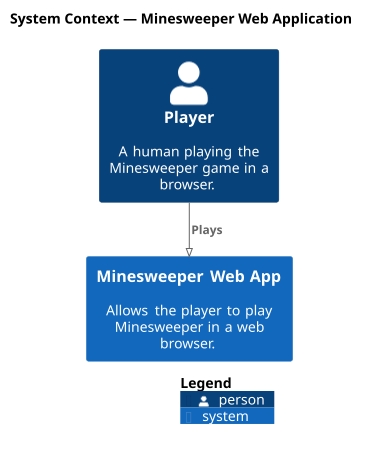

# 3. Context and Scope

## 3.1 Business Context

### System Scope

The Minesweeper Web Application is a single-player game that runs in a web browser.

### Context Diagram

The Player is the expected system user. This is inferred from the single-player application purpose. The Developer and Course instructor are stakeholders who review and maintain the architecture, but are not direct system users.

No other stakeholder groups were specified.

## 3.2 Technical Context

### External Interfaces

| Interface | Description |
|-----------|-------------|
| Frontend → Backend | REST API for game state operations |
| Backend → Database | SQLite read/write operations (through Persistence module only) |

### System Boundary

The system boundary includes the frontend (React + TypeScript) and backend (Python + FastAPI) components, along with the SQLite database. The backend is organized into five modules: API Layer, Game Session, Game Engine, Board Management, and Persistence. The system exposes a REST API for frontend communication and uses SQLite for data persistence.

## 3.3 Scope Summary

### In Scope
- Browser-based single-player Minesweeper game with classic mechanics
- React + TypeScript frontend
- Python + FastAPI backend
- REST API for frontend-backend communication
- SQLite database (accessed only through Persistence module)
- Modular monolith architecture with API Layer, Game Session, Game Engine, Board Management, and Persistence modules

### Out of Scope
- Authentication or user accounts
- Multiplayer functionality

---

*Previous chapter: 2. Constraints*

*Next chapter: 4. Solution Strategy*
