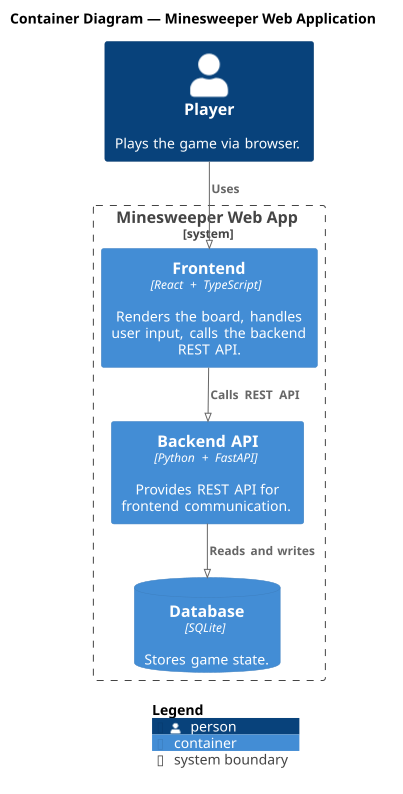
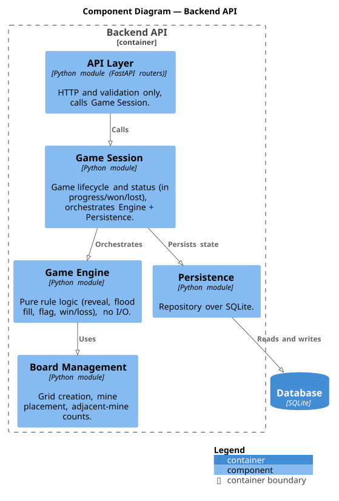

# 5. Building Block View

## 5.1 Whitebox Overview

The overall software architecture consists of:

- Frontend (React + TypeScript)
- Backend (Python + FastAPI)
- Database (SQLite)

The backend is organized as a modular monolith with five internal modules:

- API Layer (FastAPI routers)
- Game Session
- Game Engine
- Board Management
- Persistence

## 5.2 API Layer

| Aspect | Description |
|--------|-------------|
| Name | API Layer |
| Technology | Python module (FastAPI routers) |
| Responsibilities | HTTP and validation only, calls Game Session |
| Interfaces | REST API endpoints: POST /games, GET /games/{id}, POST /games/{id}/reveal, POST /games/{id}/flag |
| Dependencies | Game Session module |

## 5.3 Game Session

| Aspect | Description |
|--------|-------------|
| Name | Game Session |
| Technology | Python module |
| Responsibilities | Game lifecycle and status (new/in_progress/won/lost), orchestrates Engine + Persistence |
| Interfaces | create_game(difficulty) -> GameState, get_game(id) -> GameState, reveal(id, row, col) -> GameState, toggle_flag(id, row, col) -> GameState |
| Dependencies | Game Engine, Persistence modules |

## 5.4 Game Engine

| Aspect | Description |
|--------|-------------|
| Name | Game Engine |
| Technology | Python module |
| Responsibilities | Pure rule logic (reveal, flood fill, flag, win/loss), no I/O |
| Interfaces | reveal(board, row, col) -> Board, toggle_flag(board, row, col) -> Board, evaluate_status(board) -> Status |
| Dependencies | Board Management module |

## 5.5 Board Management

| Aspect | Description |
|--------|-------------|
| Name | Board Management |
| Technology | Python module |
| Responsibilities | Grid creation, mine placement, adjacent-mine counts |
| Interfaces | create_empty(rows, cols) -> Board, place_mines(board, count, safe_cell) -> Board, adjacent_counts(board) -> Board |
| Dependencies | None |

## 5.6 Persistence

| Aspect | Description |
|--------|-------------|
| Name | Persistence |
| Technology | Python module |
| Responsibilities | Repository over SQLite |
| Interfaces | save(game), load(id) -> Game | None |
| Dependencies | SQLite database |

## 5.7 Container Diagram

## 5.8 Component Diagram

---

*Previous chapter: 4. Solution Strategy*

*Next chapter: 6. Runtime View*
