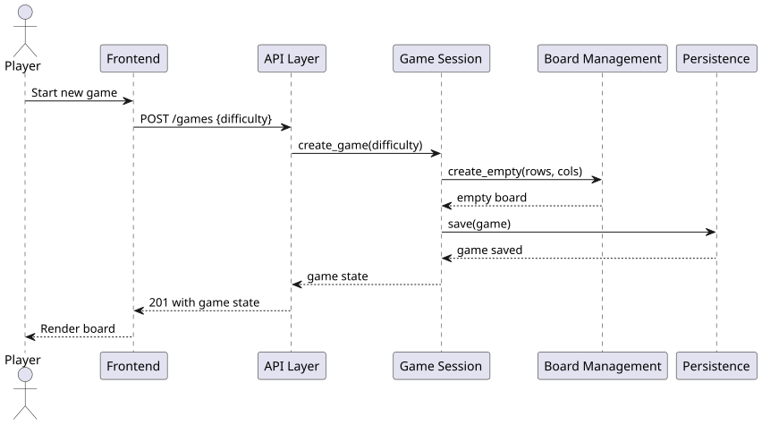
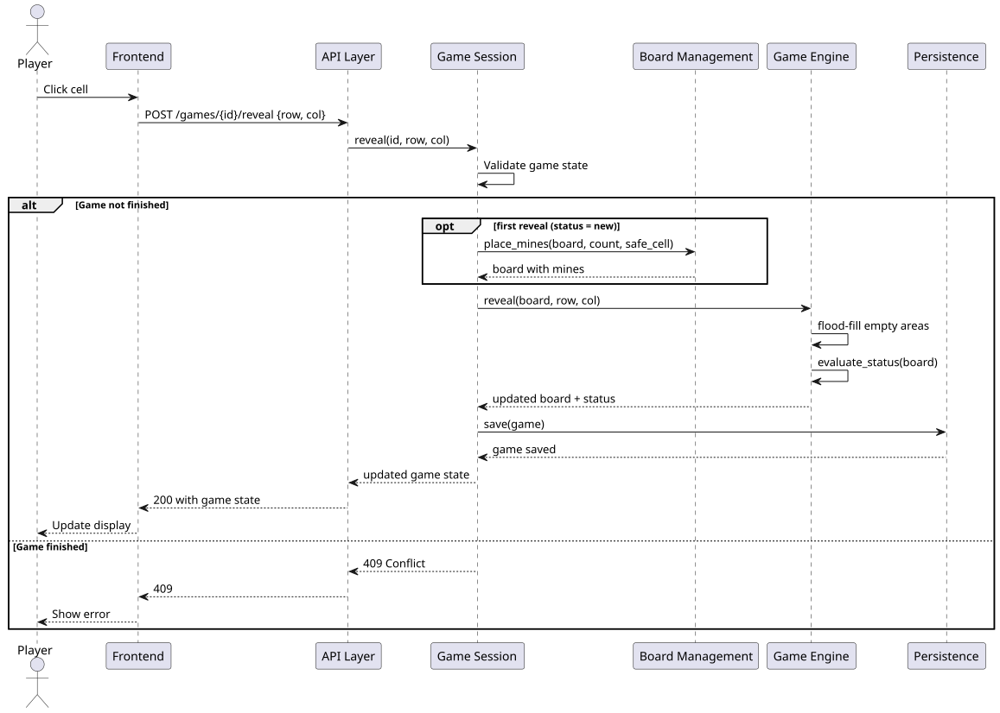

# 6. Runtime View

## 6.1 Overview

The runtime behavior is based on confirmed API contracts and module responsibilities.

## 6.2 Game Initialization Flow

1. Player starts a new game
2. Frontend makes POST /games request with difficulty parameter
3. Backend API Layer receives request and validates input
4. Backend Game Session calls Board Management to create empty board (dimensions only)
5. Backend Game Session creates new session with status `new` (empty board, no mines)
6. Backend calls Persistence to save game state to SQLite
7. Backend returns 201 with initial game state
8. Frontend renders the board

## 6.3 First Reveal Flow

1. Player clicks a cell to reveal
2. Frontend sends POST /games/{id}/reveal with row and col
3. Backend API Layer receives request and validates coordinates
4. Backend Game Session validates game state (not finished)
5. Backend Game Session detects status is `new`, calls Board Management:
   - Place mines on the board, excluding the clicked cell
   - Calculate adjacent mine counts
6. Backend Game Session calls Game Engine:
   - Reveal the clicked cell
   - Perform flood-fill for empty areas
   - Evaluate game status (win/loss/continue)
7. Backend calls Persistence to save updated state to SQLite
8. Backend returns updated game state
9. Frontend updates display

## 6.4 Subsequent Moves Flow

1. Player performs action (reveal cell, toggle flag)
2. Frontend sends POST /games/{id}/reveal or POST /games/{id}/flag with row and col
3. Backend API Layer receives request, validates coordinates
4. Backend Game Session validates game state (not finished):
   - If game already finished, returns 409 Conflict
5. Backend Game Engine applies rule logic (reveal, flag, win/loss check)
6. Backend calls Persistence to save updated state to SQLite
7. Backend returns updated game state
8. Frontend updates display

## 6.5 Error Handling

| Error | Scenario |
|-------|----------|
| 404 | Request for unknown game ID |
| 409 | Move on finished game |
| 422 | Invalid coordinates |

## 6.6 Interactions

| Module | Interaction |
|--------|-------------|
| Frontend | Calls REST API endpoints, receives game state responses |
| API Layer | HTTP validation, calls Game Session |
| Game Session | Lifecycle management, orchestrates Engine + Persistence |
| Game Engine | Pure rule logic, uses Board Management |
| Board Management | Grid creation, mine placement (on first reveal only), adjacent counts |
| Persistence | SQLite repository, called by Game Session |

## 6.7 Concurrency

One player per game; no concurrent writes to the same game.

## 6.8 Sequence Diagrams

### New Game Creation

### Reveal Cell Sequence

---

*Previous chapter: 5. Building Block View*

*Next chapter: 7. Deployment View*
