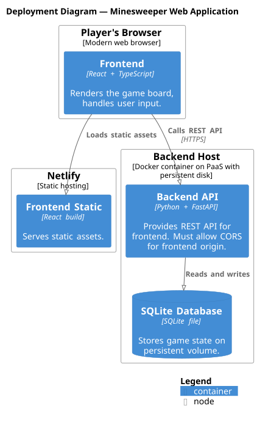

# 7. Deployment View

## 7.1 Overview

The system uses separate deployment for frontend and backend components. SQLite is accessed only through the Persistence module and is stored as a file on a persistent volume attached to the backend node.

## 7.2 Runtime Environment

| Node | Description |
|------|-------------|
| Player's Browser | Loads static frontend assets and calls backend REST API directly |
| Static Hosting | Hosts React application as static assets |
| Backend Host | Single Docker container running FastAPI with uvicorn; SQLite file stored on attached persistent volume |

## 7.3 Deployment Diagram

The player's browser loads static assets from the static host and calls the backend REST API directly over HTTPS. The frontend host never talks to the backend. The backend must allow the frontend origin via CORS.

## 7.4 Deployment Scenarios

### Development
- Frontend: Local development server (e.g., `npm start`)
- Backend: Local FastAPI server (e.g., `uvicorn main:app --reload`)
- Database: Local SQLite file in backend working directory

### Production
- Frontend: Static assets deployed to Netlify
- Backend: Single Docker container deployed to PaaS with persistent disk (e.g., Fly.io volume or Render disk)
- Database: SQLite file stored on persistent volume attached to backend

## 7.5 Scaling Considerations

- Frontend: Horizontal scaling via CDN or static hosting
- Backend: Limited to 1 instance due to SQLite embedded database
- Database: SQLite file on persistent volume; single-instance writes only

---

*Previous chapter: 6. Runtime View*

*Next chapter: 8. Cross-Cutting Concepts*
